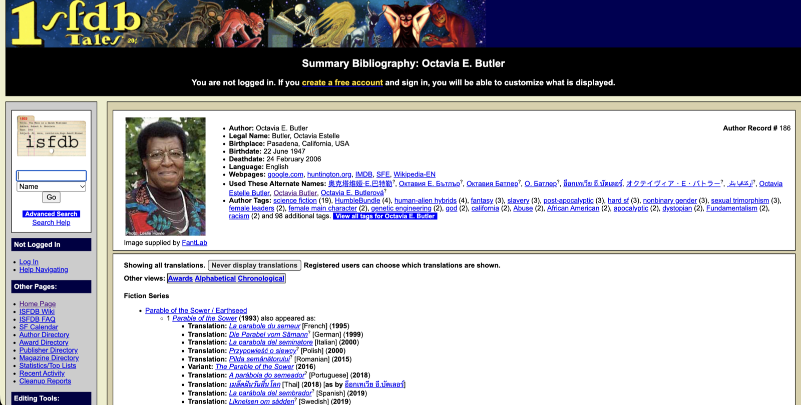
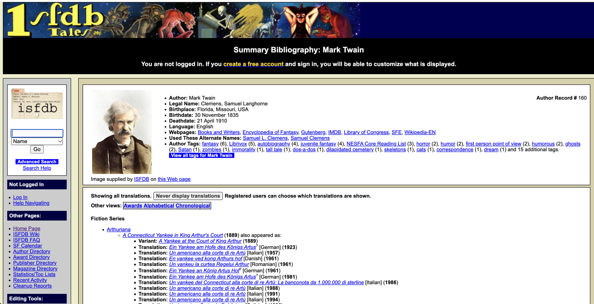

 {fig-align="center"}

<!-- Include brief introduction to/description of data essay  -->

<!-- If there are multiple datasets, please provide a title for each dataset with its own description  -->

<!-- # 1. Title of dataset 1 -->

# Interactive Visualizations

<!--
The charts in this essay are plain {python} cells (polars + plotly).
This first cell loads the data and builds everything; the cells placed
through the essay just display one chart or table each, so they can be
moved freely.
To re-render: python -m pip install polars plotly pandas jupyter, then quarto preview.
Commit website/_freeze/ with the post: the site's GitHub Action has no Python,
so it uses the frozen results.
-->

```{=html}
<style>
/* Compact, scrolling tables for the chart cells */
.compact-table { max-height: 420px; overflow: auto; font-size: 0.85rem; margin-bottom: 1rem; }
.compact-table table { margin-bottom: 0; }
.compact-table th, .compact-table td { padding: 0.2rem 0.6rem !important; }
.compact-table thead th { position: sticky; top: 0; background: var(--bs-body-bg, white); }
/* Let long URLs in the bibliography wrap on phones */
#refs .csl-entry { overflow-wrap: anywhere; }
</style>
```

```{python}
#| echo: false

# --- Settings ---------------------------------------------------------------

# Same CSV the data table uses
DATA_URL = "https://raw.githubusercontent.com/Post45-Data-Collective/data/refs/heads/main/speculative_fiction_novels/speculative-fiction-novels-dataset-CSV.csv"

BAR_COLOR = "purple"
CHART_HEIGHT = 400
CHART_MARGINS = dict(l=80, r=20, t=70, b=100)  # room for axis labels
TOP_N = 25  # rows shown in the author and series tables
LANGUAGE_BUTTONS = [10, 20, None]  # "Top N" buttons on the languages chart; None = all, first is the default
TOP_LANGUAGES = 5  # languages shown separately in translations per decade; the rest are "Other"
LANGUAGE_COLORS = ["#7b2d8e", "#e69f00", "#009e73", "#0072b2", "#d55e00", "#999999"]

# ISO 639-2 codes in orig_lang
LANGUAGE_NAMES = {
    "afr": "Afrikaans", "ara": "Arabic", "baq": "Basque", "ben": "Bengali",
    "bos": "Bosnian", "bul": "Bulgarian", "cat": "Catalan", "chi": "Chinese",
    "cze": "Czech", "dan": "Danish", "dut": "Dutch", "est": "Estonian",
    "fin": "Finnish", "fre": "French", "geo": "Georgian", "ger": "German",
    "gle": "Irish", "glg": "Galician", "gre": "Greek", "heb": "Hebrew",
    "hin": "Hindi", "hrv": "Croatian", "hun": "Hungarian", "ice": "Icelandic",
    "ind": "Indonesian", "ita": "Italian", "jpn": "Japanese", "kir": "Kyrgyz",
    "kor": "Korean", "mal": "Malayalam", "mar": "Marathi", "may": "Malay",
    "nno": "Norwegian Nynorsk", "nob": "Norwegian Bokmål", "nor": "Norwegian",
    "pol": "Polish", "por": "Portuguese", "rum": "Romanian", "rus": "Russian",
    "sah": "Yakut", "san": "Sanskrit", "scc": "Serbian (old code)",
    "scr": "Croatian (old code)", "slv": "Slovenian", "spa": "Spanish",
    "srp": "Serbian", "swe": "Swedish", "tha": "Thai", "tur": "Turkish",
    "ukr": "Ukrainian", "uzb": "Uzbek", "wel": "Welsh", "yid": "Yiddish",
    "yor": "Yoruba",
}

# -----------------------------------------------------------------------------

import os

import polars as pl
import plotly.express as px
import plotly.io as pio
from IPython.display import Markdown

pio.templates.default = "none"

# Set SPECFIC_DATA to a local CSV path to render from that copy instead
DATA_URL = os.environ.get("SPECFIC_DATA", DATA_URL)


def show_table(df):
    """Display a polars DataFrame as a compact Markdown table in a scrolling box."""
    header = "| " + " | ".join(df.columns) + " |"
    # Right-align number columns
    divider = "| " + " | ".join("---:" if dtype.is_integer() else "---" for dtype in df.dtypes) + " |"
    rows = [
        "| " + " | ".join(f"{v:,}" if isinstance(v, int) else str(v) for v in row) + " |"
        for row in df.iter_rows()
    ]
    table = "\n".join([header, divider] + rows)
    return Markdown(f"::: {{.compact-table}}\n\n{table}\n\n:::")


charts_shown = 0


def show_chart(fig, xaxis_title, yaxis_title, recolor=True, margins=None):
    """Style a bar chart and embed it, loading plotly.js only with the first one.
    Passed as a raw HTML block, not HTML(): any HTML output makes Quarto add
    require.js, which stops the Tabulator data table from loading."""
    global charts_shown
    charts_shown += 1
    if recolor:
        fig.update_traces(marker_color=BAR_COLOR)
    if fig.data[0].orientation == "h":
        fig.update_traces(hovertemplate="%{y}: %{x:,}<extra></extra>")
    elif recolor:
        fig.update_traces(hovertemplate="%{x}: %{y:,}<extra></extra>")
    else:
        fig.update_traces(hovertemplate="%{x}, %{fullData.name}: %{y:,}<extra></extra>")
    fig.update_layout(
        xaxis_title=xaxis_title,
        yaxis_title=yaxis_title,
        title_x=0.5,
        hoverlabel={"bgcolor": "white"},
        margin=CHART_MARGINS | (margins or {}),
    )
    html = fig.to_html(
        full_html=False,
        include_plotlyjs="cdn" if charts_shown == 1 else False,
        include_mathjax=False,
    )
    return Markdown(f"```{{=html}}\n{html}\n```")


# Load the dataset
init_df = pl.read_csv(DATA_URL, infer_schema=False, schema_overrides={"work_id": pl.Int64})

# Add the fields used for plotting.
# Publication year = earliest of original year and English translation year.
# "unpublished" becomes 9999 so it sorts last; those rows stay out of the time charts.
novels_df = (
    init_df.with_columns(
        pl.col("authors").str.split(" + ").alias("author_list"),
        pl.when(pl.col("year") == "unpublished")
        .then(pl.lit("9999"))
        .otherwise(pl.col("year"))
        .alias("year_str"),
    )
    .with_columns(
        pl.min_horizontal("year_str", "translation_year").str.to_integer().alias("min_year")
    )
    .with_columns((pl.col("min_year") // 10 * 10).alias("decade"))
    .with_columns(
        pl.when(pl.col("min_year") < 1900)
        .then(pl.lit("1800s"))
        .otherwise(pl.col("decade").cast(pl.String) + "s")
        .alias("period")
    )
)
published_df = novels_df.filter(pl.col("min_year") < 9999)
is_collab = pl.col("authors").str.contains(r" \+ ")


# Counts for the whole dataset and each decade
def describe(df):
    """Counts of interest for one slice of the dataset."""
    translations = df.filter(pl.col("orig_lang") != "eng")
    return {
        "Novels": df.height,
        "Novels with ISBNs": df.filter(pl.col("isbns").is_not_null()).height,
        "English Translations": translations.height,
        "Non-English Languages": translations.get_column("orig_lang").n_unique(),
        "Authors": df.get_column("author_list").explode().n_unique(),
        "Collaborations": df.filter(is_collab).get_column("authors").n_unique(),
        "Book Series (direct)": df.get_column("series").drop_nulls().n_unique(),
        "Book Series (root)": df.get_column("root_series").drop_nulls().n_unique(),
    }


periods = sorted(published_df.get_column("period").unique().to_list())
stats_df = pl.DataFrame(
    [{"Period": "1800–2025", **describe(novels_df)}]
    + [{"Period": p, **describe(published_df.filter(pl.col("period") == p))} for p in periods]
)

# Novels, authors and collaborations per decade
time_df = (
    published_df.group_by("period")
    .agg(
        pl.col("work_id").count().alias("novel_count"),
        pl.col("author_list").list.explode(empty_as_null=False).n_unique().alias("author_count"),
        pl.col("authors").filter(is_collab).n_unique().alias("collab_count"),
    )
    .sort("period")
)

# Novels per year
year_df = published_df.group_by("min_year").len("novel_count").sort("min_year")

# Translations by original language, largest first
translations = novels_df.filter(pl.col("orig_lang") != "eng").with_columns(
    pl.col("orig_lang")
    .replace_strict(LANGUAGE_NAMES, default=pl.col("orig_lang"))
    .alias("language")
)
translation_df = translations.group_by("language").len("novel_count").sort("novel_count")

# Translations per decade, with the biggest languages shown separately
top_languages = translation_df.sort("novel_count", descending=True).head(TOP_LANGUAGES)
top_languages = top_languages.get_column("language").to_list()
translation_decade_df = (
    translations.filter(pl.col("min_year") < 9999)
    .with_columns(
        pl.when(pl.col("language").is_in(top_languages))
        .then(pl.col("language"))
        .otherwise(pl.lit("Other"))
        .alias("language_group")
    )
    .group_by("period", "language_group")
    .len("novel_count")
    .sort("period")
)

# Authors with the most novels, and how many people they co-wrote with
author_df = (
    novels_df.with_columns(pl.col("author_list").alias("author"))
    .explode("author")
    .with_columns(
        pl.col("author_list").list.set_difference(pl.concat_list("author")).alias("co_authors")
    )
    .group_by("author")
    .agg(
        pl.col("work_id").count().alias("Novels"),
        pl.col("co_authors").list.explode(empty_as_null=False).unique().drop_nulls().alias("co_author_list"),
    )
    .with_columns(pl.col("co_author_list").list.len().alias("Co-authors"))
    .sort("Novels", descending=True)
    .rename({"author": "Author"})
    .select("Author", "Novels", "Co-authors")
)

# Series and root series
series_df = (
    novels_df.filter(pl.col("series").is_not_null())
    .group_by("series")
    .agg(
        pl.col("work_id").count().alias("novel_count"),
        pl.col("series_tree").first(),
        pl.col("root_series").first(),
        pl.col("author_list").list.explode(empty_as_null=False).unique().alias("author_names"),
    )
    .with_columns(pl.col("author_names").list.len().alias("author_count"))
)
direct_series_table = (
    series_df.sort("novel_count", descending=True)
    .select(
        pl.col("series").alias("Series"),
        pl.col("novel_count").alias("Novels"),
        pl.col("author_count").alias("Authors"),
    )
    .head(TOP_N)
)
root_series_table = (
    series_df.group_by("root_series")
    .agg(
        pl.col("novel_count").sum().alias("Novels"),
        pl.col("author_names").list.explode(empty_as_null=False).n_unique().alias("Authors"),
        pl.col("series").n_unique().alias("Series"),
    )
    .sort("Novels", descending=True)
    .rename({"root_series": "Root Series"})
    .head(TOP_N)
)


def time_chart(item_type):
    """Bar chart of novels, authors or collaborations per decade."""
    item_name = "Collaboration" if item_type == "collab" else item_type.capitalize()
    fig = px.bar(
        time_df,
        x="period",
        y=f"{item_type}_count",
        height=CHART_HEIGHT,
        title=f"{item_name}s per Decade",
    )
    return show_chart(fig, "Publication Year*", f"# of {item_name}s")
```

Drag the handles on the slider below the chart to zoom in on any period.

```{python}
#| echo: false
fig = px.bar(
    year_df,
    x="min_year",
    y="novel_count",
    height=CHART_HEIGHT + 100,
    title="Speculative Fiction Novels in English<br>(1800–2025)",
)
fig.update_xaxes(rangeslider_visible=True)
show_chart(fig, "Publication Year*", "# of Novels")
```

\*Publication year in these charts is the earliest known publication year of the original novel or its English translation.


# **Data Table**

```{ojs}
//| echo: false
import {viewof dataSummaryView, Tabulator, viewof selectedColumns, viewof dataSet, tableContainer, fetchData, generateTabulatorTableFromCSV, progress, progressbar} from "8bb63a6cde9addff"
```

```{ojs}
//| echo: false
//| output: false
raw_data = fetchData("https://raw.githubusercontent.com/Post45-Data-Collective/data/refs/heads/main/speculative_fiction_novels/speculative-fiction-novels-dataset-CSV.csv")
```

```{ojs}
//| echo: false
//| output: false
generateTabulatorTableFromCSV(
  "#table-container-specfic",
  "https://raw.githubusercontent.com/Post45-Data-Collective/data/refs/heads/main/speculative_fiction_novels/speculative-fiction-novels-dataset-CSV.csv",
  {
    displayedColumns: ["work_id", "title", "authors", "author_ids", "year", "translation_year",  "orig_lang", "series", "series_no", "isbns"],
    columnPopups: [
      "Unique identifier for this work from ISFDB—also known as “Title Record”",
      "Title of the work",
      "Author(s) of the work",
      "Unique identifier(s) for the author(s)",
      "Year of first known publication date",
      "Year of first known publication date for English translation",
      "ISO 639-2 code of the work's original language",
      "Name of the series that the work belongs to",
      "Work’s number within its series",
      "Comma-separated list of associated ISBNs"
    ],
    columnWidths: { "work_id": 100, "title": 200, "authors": 150, "author_ids": 100, "year": 100, "translation_year": 100, "orig_lang": 100, "series": 100, "series_no": 100, "isbns": 100 },
    categoryColumns: ["orig_lang"],
    linkColumns: ["author_ids", "isbns"],
    rangeSliderColumns: ["year", "translation_year"],
    sortColumns: ["work_id", "title", "authors", "year", "translation_year", "series"],
    sortOrders: ["desc", "asc"],
    buttonContainerId: "#button-container-specfic",
    rawButtonId: "#download-raw-specfic",
    urlCopyButtonId: "#copy-url-specfic",
  }
);
```

<div id="table-container-specfic" style="height: 600px;"></div>

Download Full Data (including hidden columns)

<div>
  <button id="download-raw-specfic"><i class="fas fa-download"></i> Download Full Data</button>
  <button id="copy-url-specfic"><i class="fas fa-copy"></i> Copy Full Data URL</button>
</div>

Download Table Data (including filtered options)

<div id='button-container-specfic'>
  <button id="download-csv"><i class="fas fa-download"></i> Download CSV</button>
  <button id="download-json"><i class="fas fa-download"></i> Download JSON</button>
  <button id="download-xlsx"><i class="fas fa-download"></i> Download Excel</button>
</div>

::: {.callout-tip icon="false"}
## Creative Commons License

<p xmlns:cc="http://creativecommons.org/ns#">

This work is licensed under <a href="https://creativecommons.org/licenses/by/4.0/?ref=chooser-v1" target="_blank" rel="license noopener noreferrer" style="display:inline-block;">CC BY 4.0</a>

</p>
:::

# **Significance & Context**

Speculative fiction (SF) is a wide-reaching and nebulous genre with multiple contradictory definitions. At times, it is a subgenre *of* science fiction or an interchangeable term *for* science fiction, and at others a distinct genre *separate from* science fiction or more expansively an umbrella genre *including* science fiction, fantasy, and more [@wolfe1986; @oziewicz2017]. SF’s many meanings have brought into question whether it should be considered a literary category or simply written off as a commercial one [@gill2013]. And yet the term continues to be used by authors, scholars, and readers alike.

How might we examine this wide-reaching and changing genre? How do the myriad works identified as SF relate to the genre’s multiple definitions and porous boundaries?

To even begin answering these questions, we need to know which works are identified as SF under any definition, especially the liminal works that make SF’s variable boundaries visible. The Speculative Fiction Novels in English (1800-2025) dataset provides such a foundation by compiling over 160,000 SF English-language novels first published from 1800 through 2025, drawing on the crowd-sourced [Internet Speculative Fiction Database (ISFDB)](https://www.isfdb.org/).

### Defining Speculative Fiction: A History

In its early use, SF was typically described as a prominent portion of science fiction. Robert A. Heinlein used the term interchangeably with his definition of “simon-pure science fiction” in which “human problems \[arise\] out of extrapolations of present science” [@heinlein1947]. Similarly, Judith Merril used the term to define a large swathe of science fiction that focuses on extrapolation but allows both “imaginative and inventive” changes, thereby incorporating stories that do not inherently focus on science and technology [@merril1966]. In contrast, Margaret Atwood has used SF for a distinct genre of possible extrapolation rather than the impossibilities of science fiction: “science fiction has monsters and spaceships; speculative fiction could really happen.”[^1] More recently, SF has become more widely known as a supergenre that can cover the many genres of non-mimetic fiction. The Speculative Literature Foundation (SLF) exemplifies this use by considering SF as any work “containing a fabulist or speculative element” [@slf].

### ISFDB: The Internet Speculative Fiction Database

The Internet Speculative Fiction Database (ISFDB) is an invaluable resource for compiling vast bibliographies of SF. It is a longstanding community-built and moderated database that catalogs published works of SF at both the printing and work level. ISFDB uses an inclusive definition of SF similar to SLF’s, including but not limited to science fiction, fantasy, alternate history, proto-science fiction, and the supernatural [@isfdb2024policy], and has captured more than a million printings and works.

While ISFDB indexes publicly available bibliographic data, it also includes information that may not be associated with a particular publication. With its effort to track works rather than editions, ISFDB links varying titles, printings, and translations of a work. Crucially, ISFDB makes an effort to document the true authorship of a work by incorporating public information not directly given in the publications of the work in question. This includes capturing uncredited co-authors and editors, ghost writers, and the authors behind house names.

{#fig-isfdb-butler .lightbox}

ISFDB builds on a long tradition of SF bibliographies and indices that focus not only on works contemporaneous with the modern formations of SF but also project backwards to novels of fantastic voyages, utopias and dystopias, and gothic romance. ISFDB was launched in 1995 by Al von Ruff and Ahasuerus; its immediate predecessors were the author bibliographies posted to the USENET newsgroup rec.arts.sf.written.[^2] It began as a closed database restricted to a small set of editors, and editing was opened to the general public at the end of 2006\.

While ISFDB has focused on recording data from primary sources, it also relies on the rich space of printed and digital SF bibliographies and indices. Although each resource has its own focus, different from ISFDB’s, they provide a means of verifying the accuracy and coverage of ISFDB.[^3] ISFDB also tracks secondary verifications for its publication records using eleven major genre-focused references including *The Checklist of Science-Fiction and Supernatural Fiction* by Everett F. Bleiler, *The Encyclopedia of Science Fiction* edited by John Clute and Peter Nicholls, *The Encyclopedia of Fantasy* edited by John Clute and John Grant, *The Locus Index to Science Fiction*,[^4] and the *Science Fiction, Fantasy, & Weird Fiction Magazine Index* compiled by Stephen T. Miller and William G. Contento.

Overall, ISFDB has seven core record types: title (work-level), author, publication (printing-level), book series (e.g., *Earthsea Cycle*), publication series (e.g., *Ace Double*), publisher, and award. Titles are the most frequent record type (2.5M records) because they include novels, collections, short stories, reviews, and more. Of these records, around 29% are short fiction whereas novels account for 11%. While ISFDB predominantly covers English works (1.9M titles), around a quarter are in another language with German and French being the most prevalent (278K and 112K titles, respectively). Although the majority of English titles were originally written in English, ISFDB includes over 30,000 English translations.

### Speculative Fiction Novels in English (1800-2025): A Dataset

The Speculative Fiction Novels in English (1800-2025) dataset leverages the millions of ISFDB records to curate a work-level collection of SF novels printed in English from 1800 through 2025\. The dataset contains 160,243 novels accompanied by their title, author(s), original publication year, and original language. When available, alternate titles and attributed authors, series information, and ISBNs associated with a novel are also included.

The vast majority of novels in this dataset were first published after 1945 (96%). Publication dates heavily skew towards the most recent decades with 40% of all novels published in the 2010s and 21% in the 2020s. The dataset includes over 43,000 canonical author attributions, including nearly 4,000 collaborations. It also includes over 5,000 novels translated into English. Over half of these are Japanese works, most of which (88%) were published in 2010 or later. The next most frequent languages are French (over 600\) and German (over 400\), which are spread more evenly across time.

Counts for the whole dataset and for each decade (the 19th century is collected into a single period):

```{python}
#| echo: false
show_table(stats_df)
```

This dataset focuses on SF novels for both intentional and practical reasons. From a practical perspective, ISFDB predominantly covers English works and the majority of publication records (65%) correspond to novels.[^5] Moreover, ISFDB novel data is less complex and more reliable than other forms. ISFDB record creation primarily orients around a publication (i.e., the primary source) with other records subsequently being created and linked from these submissions. Short fiction title records are created through the recording of contents for compilation and serial publications. It is very easy for non-genre short fiction to be mistakenly added into ISFDB since many collections may be predominantly but not entirely SF. Properly marking non-genre short fiction requires additional edits that cannot occur until the compilation’s publication record has been approved and added to ISFDB. In a similar vein, there can be ambiguity around whether a collection or anthology is SF since it may include both individual works that are SF and those that are not. In contrast, novels more naturally correspond to publications and are a constituent unit being judged as SF or not.

Beyond practicalities, novels are notable for their prominence in the current SF publishing world. While SF magazines still exist, the typical SF reader will be exposed more to novels since these are a common staple of bookstores and libraries. While the novel has not always been the most prominent form of SF, its history is still of interest and will in many ways reflect the general SF landscape for the contemporary reader. Novels are also of interest here because their digitized forms are more readily suitable for computational analyses: generally much less segmentation (if any) is required.

While this dataset is composed entirely of data available for viewing online at ISFDB, it has a remarkably different form. ISFDB presents this information for online reference, whereas this dataset is tailored for computational and data-driven projects, as well as a more distant, aggregated view. Additionally, this is a curated bibliography that leverages ISFDB’s records and limits its scope to the most relevant work-related information. Furthermore, transforming ISFDB’s data into a tabular form is not trivial and requires an intimate knowledge of how ISFDB records and stores information. This dataset makes ISFDB’s data more accessible for a different audience and intended use. While there are many SF bibliographies, to my knowledge, none at this scale and in tabular form has previously been available.

The immediate need this dataset serves—and why this dataset has come to exist at all—is to provide a unifying source of work-level unique identifiers for SF novels in English. This will enable researchers working with book data to use work-level records rather than the edition-level records they are often stuck with [@walsh2023]. These identifiers will make linking and cross-referencing datasets much easier, such as linking the Time Horizons of Futuristic Fiction dataset [@wythoff2025] with the extracted features (i.e., nonconsumptive texts) from SF Nexus [@sfnexus] or the 20th Century English-Language Speculative Fiction HathiTrust Research Center workset [@thompson_workset]. Similarly, it can be used for coordinating digitization efforts and as a complementary way to compare collection holdings. Additionally, these identifiers are already in use. The digital projects Classics of Science Fiction [@harris_classics] and the Historical Dictionary of Science Fiction [@sheidlower2024] link to ISFDB title records.

More generally, this dataset is of interest to anyone studying SF or genre fiction more broadly. It could also be of interest to those studying publishing practices within English-language markets. This dataset is also a great starting point for curating more specialized collections, as well as capturing important work-level metadata such as author and first publication date. Some research questions this dataset could support include:

* How has collaborative authorship for SF in English changed over time within the genre? How often are these collaborations openly credited versus operating under collective pseudonyms?  
* How has the quantity of new SF novels in English changed over time? How might author identity impact the frequency of these works?  
* How have SF book series changed over time? Have they changed in length or prevalence?  
* Do SF novels in English follow certain titling practices, and when do particular title templates arise?  
* What are the characteristics of SF novels translated into English and how have they changed over time?

# **Collection and Creation**

This dataset was compiled from the September 5, 2026 ISFDB database backup (compressed MySQL file). ISFDB releases new snapshots about once a week. From this snapshot file, I used SQL to collate author, title, and publication information that spans a number of separate tables [see @isfdb2024schema for more details] into three intermediate tabular data files. Then, using Python, I used these intermediate files to (1) create a mapping from publication records to title records, (2) assemble work-level records from the title, author, and publication information, and (3) curate these work-level records to construct the dataset of English-language novels.

### Leveraging ISFDB Records

ISFDB tracks printings through publication records and works through title records. Publication records include edition-level information such as medium (e.g., hardcover, ebook) and ISBN, but also capture variation within a book edition such as its cover art and pricing as well as the type of publication (e.g., novel, anthology). Each publication record is associated with one or more title records capturing the contents of the publication. This is especially valuable for tracking the appearances of short fiction within compilations, but also for tracking forewords and bonus material within printings.

ISFDB title records tend to operate at a work-like level and enable the linking of a title’s appearance in various publications. At its core, a title record includes a text’s title, author, original publication date, and language as well as the type of text (e.g., novel, short story, anthology). To capture the complexities of what a work actually is, title records are separated into two classes: canonical titles and variants of canonical titles. A canonical title represents the original composition of a text but also its “true” authorship even if this authorship is not explicitly credited within any publication (e.g., pseudonyms, house names).[^6] In contrast, variant titles capture published transformations of this original composition. This includes capturing minor variation in printed titles (e.g., *The Many-Colored Land* vs. *The Many-Coloured Land*) and credited authors (e.g., Octavia Butler vs. Octavia E. Butler), but also more substantive variation like translations, revised editions, and adaptations. In ISFDB, the name of a canonical title typically corresponds to a work’s first published title, but in some cases it may correspond to a later title that is more commonly known. Similarly, an author’s canonical name generally corresponds to their most recognized name within SF [@isfdb2024glossary]. So, a canonical author name may be a pseudonym rather than an author’s legal name as is the case for Cordwainer Smith and Mark Twain.[^7]  

{#fig-isfdb-twain .lightbox}
   
For the purposes of this dataset, I consider an SF work (i.e., row) to correspond to an aggregated grouping of a canonical title and its associated English variant titles. The canonical title record serves as the source of the work’s title, authorship, language, and series information, while the collective group of titles is used to gather the publication records of interest: namely standalone publications printed in English. Including variant titles is vital for gathering these publication records since a canonical record may not be associated with any publications whatsoever because a composition’s canonical title and “true” authorship may never have been used together in a publication, standalone or otherwise.

### Linking Titles and Publications

Although a publication record can be associated with more than one title record, the type of the publication indicates which title record best represents the publication as a whole. In the case of novels, a novel publication record is associated with a single novel title record. So, for the purposes of building this dataset, only novel publication records are gathered and linked with their corresponding novel title records.

### Work Selection

This dataset is intentionally limited to SF novels in the English language that appeared as standalone printed books and were originally published from the 19th century through 2025\. To achieve this, work curation spans several modalities.

**Language.** This dataset focuses on novels in English because ISFDB predominantly covers works and publications in English. This includes both works originally written in English as well as English translations.

**Time Period.** While the term speculative fiction has only existed since the mid-twentieth century, the genres which it contains have a much longer history. The 19th century was selected as the starting point of this dataset to largely retain the Anglophone precursors to the modern genres of science fiction, fantasy, and horror (e.g., the works of Mary Wollstonecraft Shelley, Edgar Allan Poe, H. G. Wells, and Jules Verne).

```{python}
#| echo: false
time_chart("novel")
```

**Publication Medium.** This dataset largely narrows its focus to traditionally published novels to better reflect the core landscape of the genre. Ideally, this dataset would limit its focus to traditionally published novels—including large, small, and independent publishers—but unfortunately this is at odds with ISFDB’s inclusive policy for published works of speculative fiction [@isfdb2024policy] which includes both self and vanity publishing. While publication records do include publisher information, with the proliferation of print on demand publishing, it is difficult to differentiate self-published works from those by independent publishers. So, instead of attempting to filter works by specific publishers, this dataset excludes works that are solely represented by e-books within ISFDB. This is effectively a proxy for whether the work (if published in the US) could be eligible for a Library of Congress Catalog Number (LCCN).

**Publication Form.** This criterion is less a curatorial choice than a limitation of ISFDB. ISFDB title records are categorized as novels based on their length [40,000+ words, @isfdb2024titletype], but these records may not be associated with any novel-type publications. This occurs when a novel-length work is only published in compilations. This will include some of the novels published as Ace Doubles which are treated as compilations since each Ace Double volume contains two books bound in a tête-bêche layout. However, this will only be true for the novels printed as Ace Doubles with no printed, standalone (i.e., novel) publication recorded within ISFDB.

**ISFDB Tags.** ISFDB novels are further filtered by two tags: Non-Genre [@isfdb2022nongenre] and Graphic Format [@isfdb2016graphic]. The former are excluded because non-genre novels by definition are not works of SF. The latter are excluded because novels are traditionally primarily textual and this tag indicates that the work contains inseparable graphic material, but also because ISFDB generally excludes graphic novels, comics, and manga [@isfdb2024policy].

### Workflow

An initial working set of title records is constructed through the following filtering process. These title records are selected if they are:

1. a novel  
2. in English  
3. published in 2025 or earlier  
4. not flagged as non-genre or having a graphic format  
5. associated with at least one printed publication record

A publication record is considered to be printed if it has (a) a printed format [see @isfdb2023format] or (b) an unknown format and was published before 2000\.

Then, with this working set of title records, work records are formed by grouping the variant titles with their canonical titles. These canonical title records may not be in the working set since they are not necessarily written in English or directly linked to a printed publication record. These works are then further filtered by the associated first publication date which for the purposes of this dataset corresponds to the publication date of the canonical title record. Works are filtered to those published in 1800 or later, which means these works were first published from 1800 through 2025\. In cases where the canonical title is unpublished in its original language, the work is included if the earliest known English translation was published in the 19th century or later. In cases where the canonical title’s publication date is unknown, the work is dropped.

### Limitations

This dataset is wholly derived from ISFDB content. ISFDB is not comprehensive and so neither is this dataset. Similarly, ISFDB’s coverage is far from neutral: works are counted only if the contributors—predominantly fans—know them and care enough to add them. Much of ISFDB’s coverage reflects the popular: Anglophone novels primarily by white, male authors.

Any errors in ISFDB records will be inherited by this dataset. Inevitably, this dataset will include novels that are not SF. Similarly, first publication dates may be wrong and translations may not be properly identified since this requires ISFDB to contain a record of the original work and be properly linked to its translation. While ISFDB has a vast number of publication records it is far from complete and many ISBNs associated with a novel may be missing.

There are also limitations with the dataset’s curatorial workflow since it relies on ISFDB’s capture of printed publications. Less popular novels may be recorded in ISFDB, but only through ebook publications which means that they will be excluded from this dataset. Similarly, this dataset is dependent on ISFDB’s categorization of titles which defines novels in terms of length. Due to the blurry boundary between novels and novellas, some novels may be recorded as novellas in ISFDB and vice versa. An additional edge case is the fix-up and mosaic novel; in some cases these works will be recorded as collections rather than novels and thus be excluded from this dataset.

# **Dataset Description**

Each row of the dataset corresponds to a single work (i.e., SF novel).

**work\_id**  
The unique identifier for this work. This is the title record ID for the canonical title record associated with this work. The specific values are not inherently meaningful, it corresponds to when the title record was added to ISFDB. An ISFDB title record may be viewed at https://www.isfdb.org/cgi-bin/title.cgi?\[work\_id\] 

**title**  
The “canonical” title of the work. This is the title name of the canonical title record. This may correspond to the first published title or the most well-known title. For translated works, the title will be the original title in its original language.

**authors**  
The “canonical” author(s) of the work. These are the authors of the canonical title record. If there are multiple authors, their names will be separated by plus signs ( \+ ). For translated works, the author’s name will be in the work’s original language. Unknown (i.e., uncredited or unknown ghostwriter) authors are represented as “\[unknown\]”.

```{python}
#| echo: false
time_chart("author")
```

```{python}
#| echo: false
time_chart("collab")
```

**author\_ids**  
The unique identifier(s) for the “canonical” author(s). When there are multiple authors, the IDs are separated by commas and in the same order as the **authors** column. ISFDB requires author names to be unique, so distinct authors with the same name may include parentheticals for differentiation. These IDs are the ISFDB author record IDs for these authors. An author record may be viewed at https://www.isfdb.org/cgi-bin/ea.cgi?\[author\_id\]

```{python}
#| echo: false
#| output: asis
print(f"The top {TOP_N} of {author_df.height:,} authors by number of novels:\n")
print(show_table(author_df.head(TOP_N)).data)
```

**year**  
Year of first known publication date of the work. This corresponds to the publication date of the canonical title record. In cases where a work is only published in translation, this field will be marked “unpublished”.

**translation\_year**  
Year of first known publication date for an English translation of this work. This field is only used for works of translation. This corresponds to the publication date for the earliest English variant title of the canonical title record. While rare, it is possible for English translations to be published before a novel is published in its original language.

**orig\_lang**  
The ISO 639-2 code of the language in which the work was originally written.

Use the buttons to show more or fewer languages.

```{python}
#| echo: false
BAR_HEIGHT = 22  # pixels per language


def language_view(n):
    """Axis range and chart height that show the top n languages (or all)."""
    n = n or translation_df.height
    total = translation_df.height  # bars are sorted smallest to largest, bottom to top
    return {"yaxis.range": [total - n - 0.5, total - 0.5], "height": BAR_HEIGHT * n + 170}


buttons = [
    dict(
        label=f"Top {n}" if n else f"All {translation_df.height}",
        method="relayout",
        args=[language_view(n)],
    )
    for n in LANGUAGE_BUTTONS
]

fig = px.bar(
    translation_df,
    x="novel_count",
    y="language",
    orientation="h",
    text="novel_count",
    title="English Translations by Original Language",
    log_x=True,
)
fig.update_traces(textposition="outside", cliponaxis=False)
fig.update_yaxes(tickfont_size=11)
default_view = language_view(LANGUAGE_BUTTONS[0])
fig.update_layout(
    height=default_view["height"],
    yaxis_range=default_view["yaxis.range"],
    updatemenus=[
        dict(type="buttons", direction="right", buttons=buttons, x=0, xanchor="left", y=1.0, yanchor="bottom", pad=dict(b=8))
    ],
)
show_chart(fig, "# of Novels (log scale)", "", margins=dict(l=130, t=110))
```

Japanese novels make up over half of all translations, and most of them appeared in English from 2010 on; French, German and Russian translations are spread more evenly across time.

```{python}
#| echo: false
fig = px.bar(
    translation_decade_df,
    x="period",
    y="novel_count",
    color="language_group",
    category_orders={
        "language_group": top_languages + ["Other"],
        "period": periods,
    },
    color_discrete_sequence=LANGUAGE_COLORS,
    height=CHART_HEIGHT + 50,
    title="English Translations per Decade",
    labels={"language_group": "Original Language"},
)
fig.update_layout(
    legend=dict(orientation="h", x=0.5, xanchor="center", y=-0.35, yanchor="top")
)
show_chart(
    fig, "Publication Year*", "# of Translated Novels", recolor=False, margins=dict(b=170)
)
```

**series**  
The name of the series that the work belongs to. This field will be empty if the work does not belong to a series. For translations, the series name is typically in the work’s original language. ISFDB requires series names to be unique, so a series name may include a parenthetical for disambiguation.

**series\_no**  
The work’s number within its series (i.e., **series** column). This field may be empty.

**series\_tree**  
Since ISFDB allows series to nest infinitely, this field shows a work’s series tree. Each series name is separated by a right bracket ( \> ) where each series is the child of the neighbor to its right. So, the **series** column corresponds to the leftmost series and **root\_series** to the rightmost. This field will be the same as the **series** column when the work’s series has no parent series.

**root\_series**  
The name of the broadest (“root”) series to which this work belongs. This field will be the same as the **series** column when the work’s series has no parent series.

```{python}
#| echo: false
#| output: asis
print(f"The top {TOP_N} series by number of novels:\n")
print(show_table(direct_series_table).data)
print(f"\n\nThe top {TOP_N} root series by number of novels:\n")
print(show_table(root_series_table).data)
```

**alt\_titles**  
A list of alternate published titles for this work with titles separated by vertical bars ( | ). These titles will always correspond to English editions of the work. This field may be empty.

**alt\_authors**  
A list of alternate published authors for this work with distinct credited authorships separated by vertical bars ( | ). Similar to the **authors** column, for authorships with multiple authors, their names are separated by plus signs ( \+ ). In cases where the work was published with no credited author, the list will include “\[uncredited\]”. This field may be empty.

**isbns**  
A comma-separated list of associated ISBNs for this work. ISBNs are only included for printed publications in English. This field may be empty.

# **Ethical Considerations**

The underlying ISFDB database snapshots are made freely available, and all ISFDB data is explicitly licensed under CC BY 4.0. All bibliographic information collected within ISFDB is publicly available and therefore so is this dataset.

# **Versioning**

The dataset will be updated at least annually with new ISFDB snapshots to reflect a more recent version of ISFDB. While records can be removed or combined, work IDs are never reused. Additionally, each update will include all novels published within the previous calendar year (e.g., snapshots from 2027 will include novels published through 2026).

Expanded versions of this dataset may also be created and made available. These potential datasets might include other work types such as short stories and anthologies (probably as separate tables), as well as additional metadata.

While no manual corrections to novel data will be made, interventions can be made by contributing edits to ISFDB itself. An ISFDB account must be created to submit edits, but otherwise there are no restrictions. In my time working with ISFDB, I have contributed hundreds of edits to improve its data quality. Changes to ISFDB will be reflected in updated versions of the dataset through the newer database snapshots.

# **Bibliography**

::: {#refs}
:::

[^1]:  Robert Potts, “Light in the wilderness,” *The Guardian*, April 25, 2003\.

[^2]:  Many of these bibliographies are preserved in the Linköping Science Fiction & Fantasy Archive: https://www.lysator.liu.se/sf\_archive/sf-texts/authors/

[^3]:  See @isfdb2010overview for more on ISFDB’s bibliographic sources.

[^4]:  https://www.locusmag.com/index/

[^5]:  A publication record corresponds to a single book or magazine (i.e., printing). So, novels can be the majority of publication records while being a small minority of title records (i.e., contents of a publication).

[^6]:  It is ISFDB policy that all bibliographic data must come from public sources. ISFDB explicitly does not include the identities of publicly undisclosed pseudonyms [@isfdb2024policy].

[^7]:  An author’s legal name is tracked as a field within an ISFDB author record.